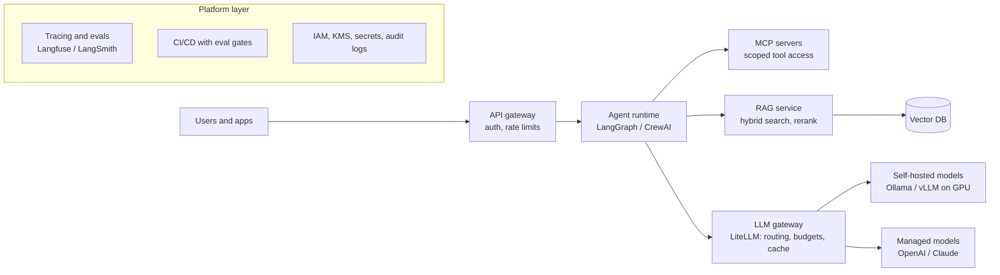
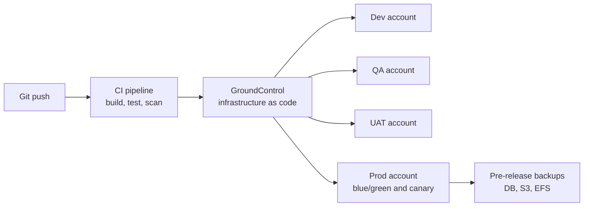

<h1 align="left">Rishi Raj Bansal</h1>

<h3 align="left">AI Infrastructure Engineer &nbsp;|&nbsp; LLMs, Agents, RAG & MCP &nbsp;|&nbsp; SaaS DevOps</h3>

Deploying and running LLMs, AI agents, RAG systems and MCP servers in production: secure, observable and cost-controlled on AWS, Azure and Kubernetes. The same production discipline, applied to SaaS platforms.

  
  
  

  
  
  
  

---

## 🙏 About Myself

AI Engineer specialized in building production-ready multi-agent systems, intelligent workflows, and Gen AI integrations. I help startups and enterprises automate decision-making, reduce costs, and launch faster using cutting-edge LLM tooling and agent frameworks. 

♦ **3+ years** deploying LLM, RAG and agent workloads in production  
♦ **12+ years** in DevOps, DevSecOps and cloud architecture  
♦ **20+ years** of total experience in Software engineering and Systems Architecture. Providing software services & solutions to various industry verticals in most reliable & consistent manner, assisting the industries to make their businesses more successful with optimum costing structure and rapid ROIs execution plans.  
♦ Built and ran a **HIPAA- and PCI DSS-compliant** AWS platform from scratch to go-live  
♦ Long-term, repeat engagements with clients in the **US, UK and EU**  
♦ **Languages:** Python ▪ Node.js / TypeScript ▪ Java ▪ Bash  

From LLM-powered AI Agents to ML infrastructure orchestration, specialize in solving complex challenges with a focus on reliability, cost-efficiency, and governance. 

<!--
🔭 Find me on: 
- 🌐 https://www.linkedin.com/in/rishirajbansal  
- 🌐 https://www.rishirajbansal.com 
- 📬 [rishi@rishirajbansal.com](mailto:rishi@rishirajbansal.com) *or* [rishiraj.specialist@gmail.com](mailto:rishiraj.specialist@gmail.com) 
-->

## ✨ Work Highlights

| Outcome | What it took |
| --- | --- |
| **$12K/month saved** on LLM API costs | Quantized open-source models self-hosted on GPU instances in a private AWS VPC, with LiteLLM routing only complex, non-sensitive requests to cloud APIs |
| **40% fewer hallucinations**, 60% faster responses, 35% higher customer satisfaction | Production RAG with incremental ingestion, multi-pass reranking, grounding checks, tracing and evaluation |
| **4x faster onboarding**, 70% of repetitive workflows automated | HIPAA-aware multi-agent automation with encryption, role-based access, audit logging and human review |
| **8-10 microservices**, zero manual release steps | GroundControl: an infrastructure-as-code platform deploying across separate Dev, QA, UAT and Prod AWS accounts |
| **99.99%+ uptime** and **30-60% cloud cost savings** | Cloud infrastructure on AWS and Azure for healthcare, finance, EdTech and SaaS clients |

## 🧭 What I Do

### 🤖 AI Infrastructure: LLMs, Agents, RAG & MCP

- **LLM serving and hosting:** self-hosted open-source models on GPU (Ollama, vLLM, TGI) with quantized formats (GGUF, GPTQ, AWQ), alongside managed APIs (OpenAI, Anthropic Claude, Cohere)
- **LLM gateway and cost control:** LiteLLM routing, fallbacks, retries, per-tenant budgets, caching and cost-per-request tracking
- **Agent runtimes:** production deployment of LangGraph, CrewAI, AutoGen and OpenAI Agents SDK agents, with state, retries, timeouts, human approval and audit trails
- **MCP servers:** deploying and securing Model Context Protocol servers that give agents controlled access to internal tools and data
- **RAG infrastructure:** ingestion pipelines, vector databases, hybrid search, reranking, index versioning and safe rebuilds
- **LLM observability and evaluation:** tracing, quality scoring, evaluation gates in CI/CD, and cost and latency dashboards
- **AI security:** private networking, PII redaction, guardrails, prompt-injection defences and least-privilege tool access

### ⚙️ SaaS DevOps

- **Cloud foundations:** multi-account AWS environments, networking, IAM, encryption and guardrails; Azure
- **Infrastructure as code:** Terraform, AWS CDK, CloudFormation and Pulumi
- **Containers and orchestration:** Docker, ECS Fargate, Kubernetes (EKS and self-managed), Helm
- **CI/CD and release engineering:** GitHub Actions, GitLab CI, Bitbucket Pipelines, Jenkins, AWS CodeBuild and CodePipeline; blue/green and canary releases with tested rollbacks
- **Observability and reliability:** Datadog, Prometheus, Grafana, CloudWatch, X-Ray; alerting, runbooks and backups
- **Security and compliance:** HIPAA and PCI DSS implementation; secrets management, WAF, audit logging and access control

## 🏗️ Reference Architecture: Production AI Platform

How I typically structure an AI platform so it stays secure, observable and affordable as usage grows:

**Design principles**

1. **One gateway for every model call:** routing, fallbacks, budgets and cost tracking live in one place, so changing a model is a config change, not a code change.
2. **Private by default:** sensitive workloads stay inside the VPC; external model calls are allow-listed and redacted.
3. **Agents get least privilege:** every tool or MCP server has its own scoped identity, validated inputs and an audit trail, with human approval for risky actions.
4. **Quality is measured, not assumed:** traces on every request, evaluation datasets, and CI gates that block regressions.
5. **Everything is code:** infrastructure, prompts, routing rules, dashboards and alerts are versioned and reviewed.

## 💼 Featured Work

### 🏥 EngagedMD: AWS platform built from scratch to go-live
*Healthcare SaaS used by 160+ fertility clinics · DevOps Engineer & Cloud Architect · 2020-2026*

- Architected and built the complete AWS infrastructure for a **HIPAA- and PCI DSS-compliant** platform.
- Built **GroundControl**, the infrastructure-as-code platform (Terraform, AWS CDK, CloudFormation) that deploys and manages every EngagedMD application, with no manual release or maintenance steps.
- Ran release management for **8-10 microservices on ECS Fargate** across separate Dev, QA, UAT and Prod AWS accounts.
- Implemented **blue/green and canary deployments**, rollback plans for infrastructure, application and database changes, and automated database, S3 and EFS backups before every production release.
- Monitoring and alerting with Datadog, X-Ray, Grafana and CloudWatch; low-level infrastructure designs and request-flow diagrams.
- **Stack:** ECS Fargate, ECR, App Mesh, Cloud Map, RDS PostgreSQL, RDS Proxy, MemoryDB/ElastiCache, SQS, SNS, EventBridge, Lambda, API Gateway, ALB, CloudFront, WAF, Secrets Manager; Node.js/TypeScript (NestJS, Next.js)

### 🔒 Private LLM platform: $12K/month saved
*Finance company, 200+ employees*

- Problem: LLM API bills climbing every month, and sensitive data leaving the network.
- Built: quantized open-source models served by Ollama on GPU instances in an Auto Scaling group inside a private AWS VPC; a LiteLLM router on Fargate sends only complex, non-sensitive requests to cloud APIs; IAM least privilege, Secrets Manager, CloudWatch alarms, CloudTrail audit logs, and per-request cost tracking with Langfuse.
- Result: **$12K/month saved**, and sensitive data stays in-house.

### 📚 Production RAG: 40% fewer hallucinations
*SaaS company, 400+ employees*

- Problem: a support assistant that gave unreliable answers once real users depended on it.
- Built: an incremental ingestion pipeline that re-embeds only changed documents into Pinecone, an agentic retrieval loop with multi-pass reranking and grounding checks, and LangSmith tracing with evaluation sets run before every release.
- Result: **60% faster responses, 40% fewer hallucinations, 35% higher customer satisfaction.**

### 🩺 HIPAA-aware AI agents: 4x faster onboarding
*Healthcare company, 300+ employees*

- Problem: onboarding and operations work that needed automating without putting patient data at risk.
- Built: n8n event pipelines feeding a LangGraph supervisor that routes tasks to CrewAI agents, a human review queue for low-confidence cases, and PHI protection with encryption, scoped service accounts, masking in logs and full audit logging.
- Result: **onboarding 4x faster, 70% of repetitive workflows automated.**

## 🛠️ Expertise in Depth

<b>LLM serving and model hosting</b>

- Self-hosting open-source models for private or regulated environments with Ollama, vLLM, TGI and LM Studio
- Quantization with GGUF, GPTQ and AWQ to fit models onto cost-effective hardware
- GPU instance selection, autoscaling, scale-to-zero schedules and cold-start handling
- Choosing between managed APIs and self-hosting based on volume, latency, data rules and total cost
- Evaluating models on architecture, context window, hardware requirements and task performance

<b>LLM gateway, routing and cost control</b>

- LiteLLM as a single gateway for all model calls: model aliases, fallbacks, retries and timeouts
- Routing by task complexity so small models handle simple work and large models handle the rest
- Response and prompt caching, per-tenant virtual keys, budgets and rate limits
- Cost attribution per request, feature and tenant, with alerts on unusual spend

<b>AI agents in production</b>

- Deploying agents built with LangGraph, CrewAI, AutoGen and the OpenAI Agents SDK as containerized services
- Agent state and memory (Redis, LangMem, Chroma), retries, timeouts and recovery for long-running tasks
- Multi-agent orchestration patterns: supervisor/router, sequential, parallel, planner-executor, ReAct and reflection
- Human-in-the-loop approval for risky actions, with a full audit trail of every agent decision and tool call
- Low-code agent platforms where they fit: LangFlow, Relevance AI, n8n

<b>MCP (Model Context Protocol) servers</b>

- Deploying MCP servers that give agents and AI applications structured access to internal tools, APIs and data
- Authentication and authorization for MCP endpoints, with least-privilege scopes per tool
- Input validation, rate limiting and audit logging on every tool call
- Containerized MCP deployments behind a gateway, monitored like any other production service

<b>RAG infrastructure</b>

- Ingestion pipelines: parsing, chunking, embedding (OpenAI, Cohere, Hugging Face) and incremental re-indexing
- Vector databases: Pinecone, Weaviate, Qdrant and ChromaDB, with metadata filtering and tenant separation
- Hybrid search (semantic + keyword), multi-pass reranking and grounded answers with citations
- Agentic retrieval loops that refine the query when evidence is weak
- Versioned indexes with blue/green rebuilds and instant rollback
- Document pipelines with OCR (AWS Textract, Google Vision, Tesseract) feeding retrieval

<b>LLM observability and evaluation</b>

- Tracing every request across prompts, retrieval, model calls and tool calls with LangSmith, Langfuse, AgentOps, LangWatch and LangTrace
- Token, latency and cost dashboards by model, prompt version and tenant
- Evaluation datasets built from real traffic, LLM-as-judge scoring, and online sampling of production quality
- Evaluation gates in CI/CD that block prompt or model changes when quality drops
- Alerting on hallucination rates, performance regressions and degraded response quality

<b>AI security and governance</b>

- Private networking for model traffic, with VPC endpoints and allow-listed egress
- PII scrubbing in prompts, logs and traces; payload encryption
- Prompt-injection defences and output guardrails (Guardrails AI, Rebuff)
- Secrets management with AWS Secrets Manager and HashiCorp Vault; OAuth2, RBAC and API gateways
- Threat modelling and controls aligned with HIPAA, PCI DSS, SOC 2 and GDPR requirements

<b>Cloud infrastructure and IaC</b>

- Multi-account AWS environments (Dev, QA, UAT, Prod) with separate accounts per environment
- AWS: ECS Fargate, EKS, EC2, Auto Scaling, ALB, API Gateway, Lambda, RDS, RDS Proxy, ElastiCache/MemoryDB, S3, EFS, SQS, SNS, EventBridge, CloudFront, Route 53, WAF, Secrets Manager, IAM, KMS, CloudWatch, X-Ray, CloudTrail, SageMaker
- Azure: Container Apps and Azure ML
- Infrastructure as code with Terraform, AWS CDK, CloudFormation and Pulumi
- Identity integration: AWS Cognito, Okta, SAML SSO

<b>Containers, CI/CD and release engineering</b>

- Docker, Kubernetes (EKS and self-managed), Helm and Kustomize
- CI/CD with GitHub Actions, GitLab CI, Bitbucket Pipelines, Jenkins, AWS CodeBuild, CodePipeline and CodeArtifact
- Blue/green and canary deployments, with rollback plans for infrastructure, application and database changes
- DevSecOps gates: secret scanning, infrastructure and container scanning, misconfiguration checks
- Fully automated, OS-agnostic deployments with success and failure notifications

<b>Observability and reliability</b>

- Datadog, Prometheus (kube-prometheus-stack), Grafana, CloudWatch and AWS X-Ray
- Service health checks, alerting on symptoms that matter, and runbooks for common incidents
- Automated, versioned backups before production deployments and tested restores
- NGINX, reverse proxies and Cloudflare Tunnels

## 🤝 How I Work

- **Production first:** every system ships with monitoring, alerting, rollback and documentation, not just a working demo.
- **Security from day one:** least privilege, encryption, secrets management and audit trails are part of the design, not added later.
- **Everything as code:** environments can be rebuilt, reviewed and rolled back.
- **Clear communication:** trade-offs explained in plain language to engineers and leadership alike.
- **Handover-ready:** runbooks and documentation so your team can run the system without me.

## 🏭 Industries Served

♦ **Healthcare:** [EngagedMD](https://www.engagedmd.com), [VisibleEP](https://www.visibleep.com) 
♦ **FinTech and banking:** Royal Bank of Scotland, Western Union Money Transfer, NCR/Diebold ATMs 
♦ **IT and SaaS:** [Fitrix](https://www.fitrix.com) 
♦ **Manufacturing and retail:** [Ghirardelli](https://www.ghirardelli.com), [e-SupplyLink](https://www.e-supplylink.com) 
 

## 📝 Governance & Compliances

▪ HIPAA ▪ NIST ▪ SOC 1/2/3 ▪ PCI-DSS ▪ GDPR ▪ CCPA ▪ SEC 
 

## 🏆 Awards & Achievements

- **'Core Value' award**, Sapient Corporation (US)  

- **'Technocrat' award**, Royal Bank of Scotland  

## 🧰 Tech Stack

**AI infrastructure** 

**Cloud and infrastructure as code** 

**Containers and CI/CD** 

**Observability** 

**Data, languages and tools** 

 

## 📊 GitHub Stats

 
 

<!-- ### 🔝 Top Contributed Repo -->
 

---

<b>Planning to put LLMs, agents or RAG into production, or need a SaaS platform that releases safely and scales?</b> 
Reach me on <a href="https://www.linkedin.com/in/rishirajbansal">LinkedIn</a> or at <a href="mailto:rishi@rishirajbansal.com">rishi@rishirajbansal.com</a>

